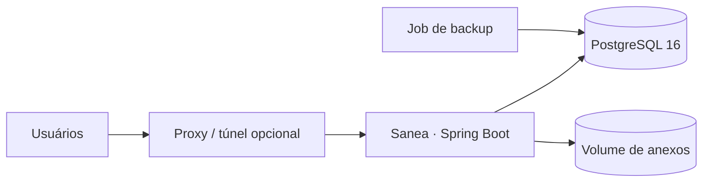

# Sanea

**Sanea** é o sistema web de gestão de chamados de esgoto: do registro pelo cidadão ao atendimento operacional, com rastreabilidade, consulta pública e operação segura via Docker.

| | |
|---|---|
| **Stack** | Java 17 · Spring Boot 3.3 · PostgreSQL 16 · Docker Compose |
| **Versão** | 1.0.0 |
| **Acesso local padrão** | `http://127.0.0.1:18473` |

---

## Índice

1. [Requisitos](#requisitos)
2. [Subir com Docker](#subir-com-docker)
3. [Configuração (`.env`)](#configuração-env)
4. [Contas iniciais](#contas-iniciais)
5. [Atualizar a aplicação](#atualizar-a-aplicação)
6. [Expor publicamente (opcional)](#expor-publicamente-opcional)
7. [O que o sistema entrega](#o-que-o-sistema-entrega)
8. [Perfis e permissões](#perfis-e-permissões)
9. [Fluxo de status](#fluxo-de-status)
10. [Arquitetura](#arquitetura)
11. [Operação](#operação)
12. [Testes](#testes)
13. [Troubleshooting](#troubleshooting)
14. [Estrutura do repositório](#estrutura-do-repositório)

---

## Requisitos

- Docker Engine e Docker Compose v2
- Portas livres: a definida em `APP_PORT` (padrão `18473`)
- Em produção: SMTP e reCAPTCHA válidos (a app **não sobe** com placeholders `CHANGE_ME`)

---

## Subir com Docker

```bash
cp .env.example .env
```

Edite o `.env` e defina pelo menos:

- senhas (`POSTGRES_PASSWORD`, `INITIAL_*_PASSWORD`)
- `APP_BASE_URL` / `APP_DOMAIN` (ex.: `http://127.0.0.1:18473`)
- `APP_BIND_IP=127.0.0.1` para acesso só na máquina local

Para desenvolvimento local sem validação estrita de segredos:

```env
SPRING_PROFILES_ACTIVE=dev
RECAPTCHA_ENABLED=false
```

Suba os serviços:

```bash
docker compose build
docker compose up -d
docker compose ps
docker compose logs -f --tail=80 santos-chamados-app
```

Healthcheck:

```text
http://127.0.0.1:18473/actuator/health
```

Interface:

```text
http://127.0.0.1:18473
```

> O Postgres **não** publica porta na máquina host; só a app é exposta.

---

## Configuração (`.env`)

O `.env` está no `.gitignore`. Use `.env.example` como modelo.

| Grupo | Variáveis |
|---|---|
| Aplicação | `APP_BASE_URL`, `APP_DOMAIN`, `APP_BIND_IP`, `APP_PORT` |
| Banco | `POSTGRES_DB`, `POSTGRES_USER`, `POSTGRES_PASSWORD` |
| Segurança | `RECAPTCHA_*`, `APP_TRUSTED_PROXIES` |
| E-mail | `SMTP_*` |
| Bootstrap | `INITIAL_ADMIN_*`, `INITIAL_CIDADAO_*`, `INITIAL_SABESP_*`, `INITIAL_PREFEITURA_*` |
| Anexos / limites | `ATTACHMENT_*`, `PUBLIC_PROTOCOL_RATE_*`, `LOGIN_*` |
| Backup | `BACKUP_SCHEDULE`, `BACKUP_RETENTION_DAYS` |
| Atendimento | `ATENDIMENTO_CIDADE`, `ATENDIMENTO_UF` |

Exemplos comuns de bind:

```env
# só localhost
APP_BIND_IP=127.0.0.1
APP_PORT=18473
APP_BASE_URL=http://127.0.0.1:18473
APP_DOMAIN=localhost

# todas as interfaces da máquina (LAN)
APP_BIND_IP=0.0.0.0
APP_BASE_URL=http://SEU_HOST:18473
APP_DOMAIN=SEU_HOST
```

---

## Contas iniciais

Criadas automaticamente na primeira subida (se ainda não existirem). Troque as senhas no `.env` antes do primeiro `up` em produção.

| Perfil | Uso |
|---|---|
| ADMIN | Administração, abertura e remoção de chamados |
| SABESP | Atendimento operacional |
| PREFEITURA | Dashboard e consulta |
| CIDADAO | Abertura e acompanhamento dos próprios chamados |

Após o primeiro login, a troca de senha pode ser exigida.

---

## Atualizar a aplicação

```bash
# atualize o código-fonte no diretório do projeto
docker compose build --no-cache santos-chamados-app
docker rm -f santos-chamados-app
docker compose up -d --no-deps --force-recreate santos-chamados-app
docker compose ps
docker compose logs -f --tail=80 santos-chamados-app
```

Se o `up` travar:

```bash
docker rm -f santos-chamados-app
docker compose up -d --no-deps santos-chamados-app
```

> Não use `docker compose down -v` em atualização rotineira — apaga volumes (banco e anexos).

---

## Expor publicamente (opcional)

A aplicação escuta HTTP no bind configurado. Para internet, coloque um proxy reverso ou túnel na frente (nginx, Caddy, Traefik, Cloudflare Tunnel, etc.).

1. Defina `APP_BASE_URL` e `APP_DOMAIN` com a URL pública (ex.: `https://chamados.exemplo.gov.br`).
2. Ajuste `APP_TRUSTED_PROXIES` para a rede do proxy.
3. Aponte o proxy/túnel para `APP_BIND_IP:APP_PORT` (ou para o host Docker correspondente).
4. Autorize o domínio nas chaves do reCAPTCHA e no SMTP.

---

## O que o sistema entrega

- Cadastro com verificação por e-mail  
- Abertura de chamado: CEP com fallback, **Estado** (UF) + cidades via IBGE, fotos, tipo de ocorrência (**Descreva o tipo** só em **Outros**), descrição com editor **WYSIWYG** (HTML sanitizado)  
- Consulta pública por protocolo  
- Fila operacional, status com histórico, mensagens (chat) e anexos  
- Dashboard, admin de usuários/tipos e auditoria  
- **Minha conta**: tema claro/escuro, cores de menu/elementos/fonte (salvas por usuário), redefinir padrão  
- Menu lateral recolhível (desktop: só ícones; mobile: hamburger + favicon)  
- RBAC, reCAPTCHA, rate limit na consulta pública, backup automático do PostgreSQL  
- **PWA**: instalável (Android/desktop/iOS “Adicionar à Tela de Início”), service worker, cache de estáticos e página offline  

> PWA exige HTTPS (ou `localhost`). Em produção atrás de Cloudflare/túnel isso já está coberto.

---

## Perfis e permissões

| Perfil | Papel |
|---|---|
| **CIDADAO** | Abre e acompanha os próprios chamados |
| **SABESP** | Atende a fila, altera status, mensagens internas |
| **PREFEITURA** | Monitora indicadores e consulta a base |
| **ADMIN** | Administra o sistema, abre e **remove** chamados |

Authorities relevantes: `CHAMADO_CRIAR`, `CHAMADO_VISUALIZAR_*`, `CHAMADO_ALTERAR_STATUS`, `CHAMADO_REMOVER`, `MENSAGEM_*`, `DASHBOARD_*`, `USUARIO_GERENCIAR`, …  

Entram na sessão no login. Depois de alterar authorities no banco (ou de uma migração que as inclua), faça **logout/login**.

---

## Fluxo de status

| De | Para |
|---|---|
| **Aberto** | Em análise · Em atendimento · Resolvido · Cancelado · Duplicado |
| **Em análise** | Em atendimento · Resolvido · Duplicado · Cancelado |
| **Em atendimento** | Resolvido · Cancelado |
| **Resolvido / Duplicado / Cancelado** | (finais) |

---

## Arquitetura



- Thymeleaf server-rendered  
- `open-in-view=false` (DTOs na view)  
- Flyway versionado — não edite migrações já aplicadas  
- Preferências de aparência por usuário (colunas em `usuario`)  
- Localidades: lista fixa de UFs + municípios via API IBGE (cache)  
- Postgres isolado na rede Compose  
- Estáticos PWA: `manifest.webmanifest`, `sw.js`, `offline.html`, `/icons/*`  

---

## Operação

### Backup

O serviço `santos-chamados-backup` executa `pg_dump -Fc` (cron padrão `0 3 * * *`) no volume `santos-chamados-backups`.

Restauração (destrutiva):

```bash
CONFIRM_RESTORE=YES ./scripts/restore-db.sh /caminho/para/backup.dump
```

Anexos: base em `scripts/sync-anexos.example.sh`.

### Emergência admin

1. Acesse o Postgres pela rede interna do Compose.  
2. Mantenha ao menos um `ADMIN` ativo.  
3. Reative ou crie usuário com hash BCrypt se necessário.  
4. Login e troca de senha imediata.  

A aplicação bloqueia desativar o último ADMIN.

---

## Testes

```bash
mvn test
```

Sem Maven local:

```bash
docker run --rm -v "$PWD":/workspace -w /workspace maven:3.9.9-eclipse-temurin-17 mvn -B test
```

No Windows (PowerShell): use `"%CD%"` no lugar de `"$PWD"`.

---

## Troubleshooting

| Sintoma | O que verificar |
|---|---|
| App Restarting / unhealthy | `docker compose logs santos-chamados-app` · valores `CHANGE_ME` no `.env` |
| Porta em uso | altere `APP_PORT` ou libere a porta |
| `compose up` trava | `docker rm -f santos-chamados-app` e `up -d --no-deps` |
| Falha Flyway | credenciais `POSTGRES_*` · não altere checksum de migração aplicada |
| reCAPTCHA | chaves e domínio autorizados · ou `RECAPTCHA_ENABLED=false` em `dev` |
| E-mail | `SMTP_*` e conectividade |
| UI antiga após rebuild | `build --no-cache` + hard refresh (e purge de cache no proxy, se houver) |
| Botão “Remover chamado” ausente | perfil ADMIN + authority `CHAMADO_REMOVER` · logout/login |
| Cidades não carregam | conectividade da app com `servicodados.ibge.gov.br` · logs da app |
| PWA não instala | HTTPS (ou localhost) · `manifest.webmanifest` e `sw.js` públicos |

---

## Estrutura do repositório

```text
src/main/java/.../santoschamados/
  auth/  usuario/  perfil/  chamado/  mensagem/  anexo/
  endereco/ (cep + localidade)  dashboard/  auditoria/  catalogo/
  infrastructure/  shared/
src/main/resources/
  db/migration/  templates/  static/ (css, js, icons, PWA)  application*.yml
docker/backup/
scripts/
compose.yaml
Dockerfile
.env.example
```

---

<p align="center">
  <sub>Sanea · Docker Compose · PostgreSQL</sub>
</p>
